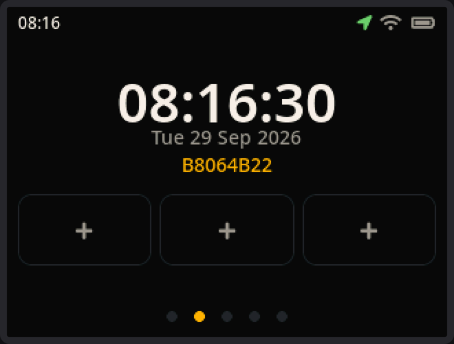

<p align="center"></p>

<h1 align="center">MeshCore Solo Companion Firmware</h1>

<p align="center">
  A fork of the official <a href="https://github.com/meshcore-dev/MeshCore">MeshCore</a> companion radio firmware with a full standalone on-device UI:<br>
  messages, contacts, GPS navigation and tools without a phone.
</p>

<p align="center">
  <a href="https://github.com/MarekZegare4/MeshCore-Solo/releases/latest"></a>
  <a href="https://solo.marekzegarek.com"></a>
  <a href="./docs/solo/README.md"></a>
  <a href="https://discord.gg/sdhYArU2jr"></a>
</p>

<p align="center">
  
  &nbsp;
  
  &nbsp;
  
</p>

<p align="center">
  <a href="https://buymeacoffee.com/MarekZegarek"></a>
</p>

---

## Supported devices

| Device | MCU | Display | Firmware file |
| ------ | --- | ------- | ------------- |
| Seeed Wio Tracker L1 (OLED) | nRF52840 | SSD1306 / SH1106 128 × 64 | `solo-<version>-WioTrackerL1.uf2` |
| Seeed Wio Tracker L1 (E-ink 2.13") | nRF52840 | 250 × 122, landscape or portrait | `solo-<version>-WioTrackerL1Eink-landscape.uf2` or `-portrait.uf2` |
| Seeed Wio Tracker L1 (E-ink 4.2") | nRF52840 | 400 × 300 | `solo-<version>-WioTrackerL1Eink42.uf2` |
| Seeed Wio Tracker L1 (E-ink 4.26") | nRF52840 | 800 × 480 | `solo-<version>-WioTrackerL1Eink426.uf2` |
| Seeed Wio Tracker L2 | ESP32-S3 | 320 × 240 touch LCD | `solo-<version>-Wio-Tracker-L2-merged.bin` |
| GAT562 30S Mesh Kit | nRF52840 | SSD1306 128 × 64 | `solo-<version>-GAT562-30S-Mesh-Kit.uf2` |
| GAT562 Mesh Watch13 *(experimental)* | nRF52840 | SSD1306 128 × 64 | `solo-<version>-GAT562-Mesh-Watch13.uf2` |
| Heltec LoRa32 V3 *(experimental)* | ESP32-S3 | SSD1306 128 × 64 | `solo-<version>-Heltec-v3-merged.bin` |
| Heltec LoRa32 V4 *(experimental)* | ESP32-S3 | SSD1306 128 × 64 | `solo-<version>-heltec-v4-merged.bin` |
| M5Stack Cardputer ADV *(experimental)* | ESP32-S3 | ST7789 TFT 240 × 135 | `solo-<version>-M5Stack-Cardputer-ADV-merged.bin` |
| LilyGO T-Echo Lite + KeyShield *(experimental)* | nRF52840 | GxEPD2 250 × 122 | `solo-<version>-LilyGo-T-Echo-Lite-keyshield.uf2` |
| ProMicro *(experimental)* | nRF52840 | SSD1306 128 × 64 | `solo-<version>-ProMicro.uf2` |
| Simpson (DIY, [schematic](./docs/solo/hardware.md#simpson)) *(experimental)* | nRF52840 | SH1106 128 × 64 | `solo-<version>-Simpson.uf2` |

Firmware files are on the [releases page](https://github.com/MarekZegare4/MeshCore-Solo/releases). Every binary serves the companion app over Bluetooth and USB serial at the same time.

Heltec V3/V4 need [a keyboard or joystick wired up](./docs/solo/hardware.md#wiring-on-the-heltec-v3--v4); ProMicro needs a CardKB; the T-Echo Lite needs the KeyShield; Simpson has its own keypad. The rest work out of the box.

---

## Flashing

> [!WARNING]
> Coming from official or other custom firmware: back up your data in the companion app, then **Erase flash** in the [MeshCore Flasher](https://meshcore.io/flasher) before flashing. Updating from an earlier Solo release doesn't need this unless the release notes say so.

**nRF52840 boards** — press reset twice quickly; the device shows up as a USB drive. Copy the `.uf2` onto it.

**ESP32-S3 boards** — flash the `-merged.bin` at offset `0x0` with the [MeshCore Flasher](https://meshcore.io/flasher) or `esptool.py --chip esp32s3 write_flash 0x0 <file>-merged.bin`. The Wio Tracker L2 then updates itself over WiFi (Settings › System › Firmware update).

---

## Documentation

[Documentation](./docs/solo/README.md) — getting started, messages, navigation, tools, settings, hardware and developer guides.

**USB tools** — [on the Solo site](https://solo.marekzegarek.com/#pc-tools) (Chrome or Edge, Web Serial): screenshots of the device's screen and the GPS trail as GPX over USB, plus a preview of any GPX file. The same as the local scripts in [tools/](./tools/README.md).

---

## Building

```sh
pio run -e <env> -t upload                                  # build and flash over USB
FIRMWARE_VERSION=v1.0.0 bash build.sh build-firmware <env>  # release artifacts into out/
```

Environments are the `*_solo_dual` (OLED / e-ink) and `*_solo_lvgl` (touch) entries in `solo/<board>/platformio.ini`. The Wio Tracker L2 needs `pio run -e Wio_Tracker_L2_idf_libs` once before its first build (it rebuilds the framework libs for its ESP-IDF options). Optional hardware (CardKB, joystick, GPIO, buzzer…) is enabled with [build flags](./docs/solo/developer/build-flags.md). Releasing: [RELEASE.md](./RELEASE.md).

This README is protected from upstream merges via `.gitattributes`; after cloning run once `git config merge.ours.driver true`.

---

## Community

Questions and feedback: the [Solo firmware thread](https://discord.com/channels/1495203904898728149/1505294337884553447) on the [MeshCore Discord](https://discord.gg/sdhYArU2jr), or an [issue](https://github.com/MarekZegare4/MeshCore-Solo/issues).

---

## Contributors

Big thanks to [vanous](https://github.com/vanous), [marczykm](https://github.com/marczykm), [tchellow](https://github.com/tchellow), [3urobeat](https://github.com/3urobeat), [pmow](https://github.com/pmow) and [sim1988son](https://github.com/sim1988son).

Built on upstream [MeshCore](https://github.com/meshcore-dev/MeshCore) and its [community](https://github.com/meshcore-dev/MeshCore/graphs/contributors).
